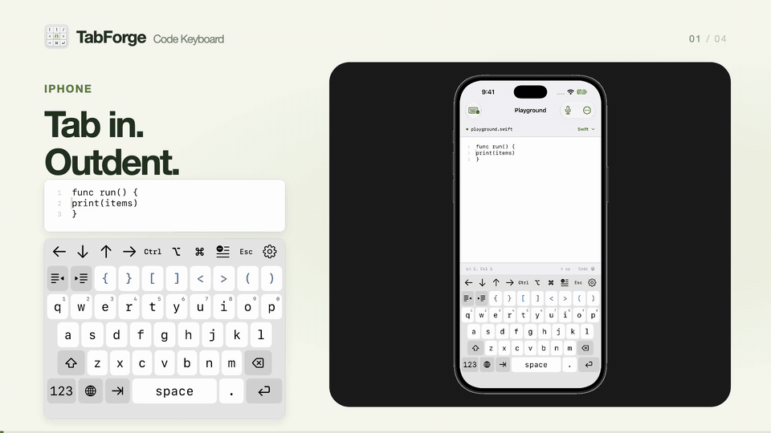
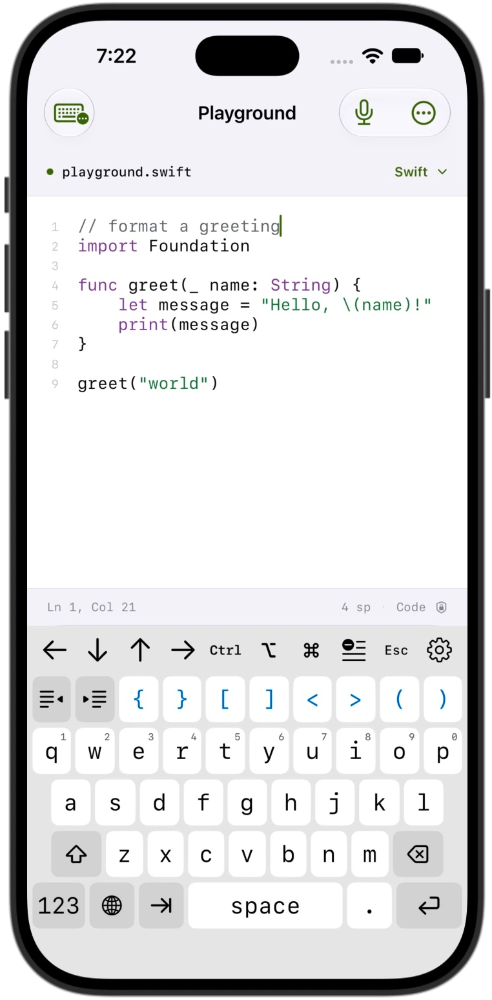
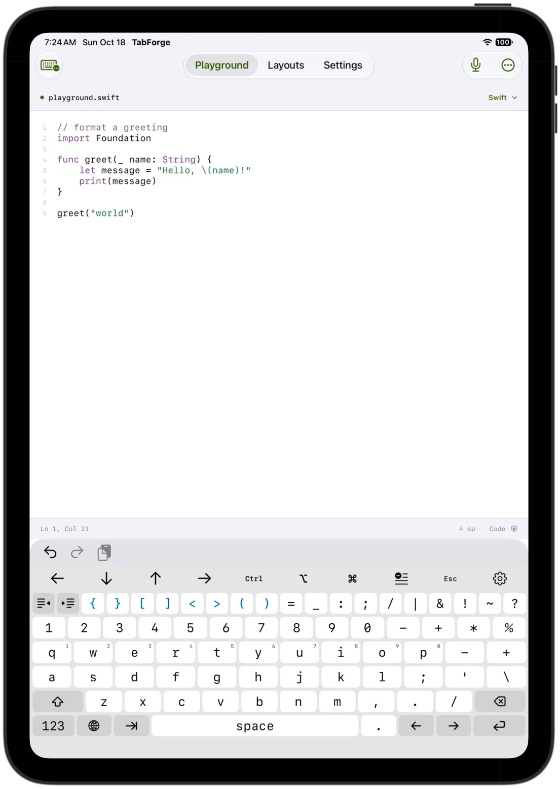
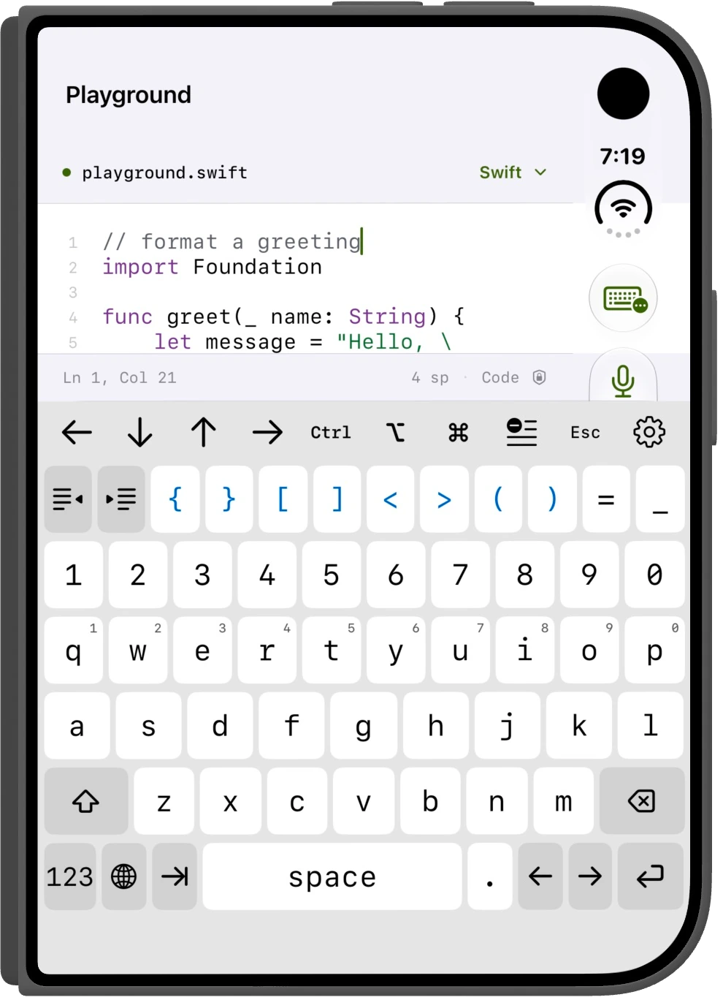
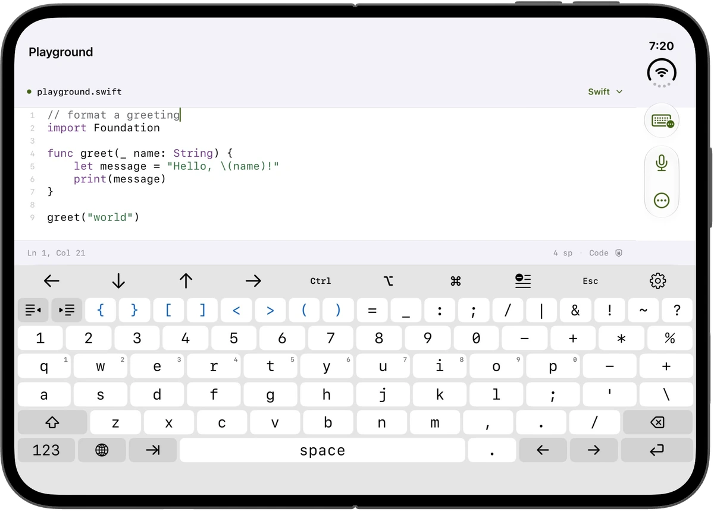
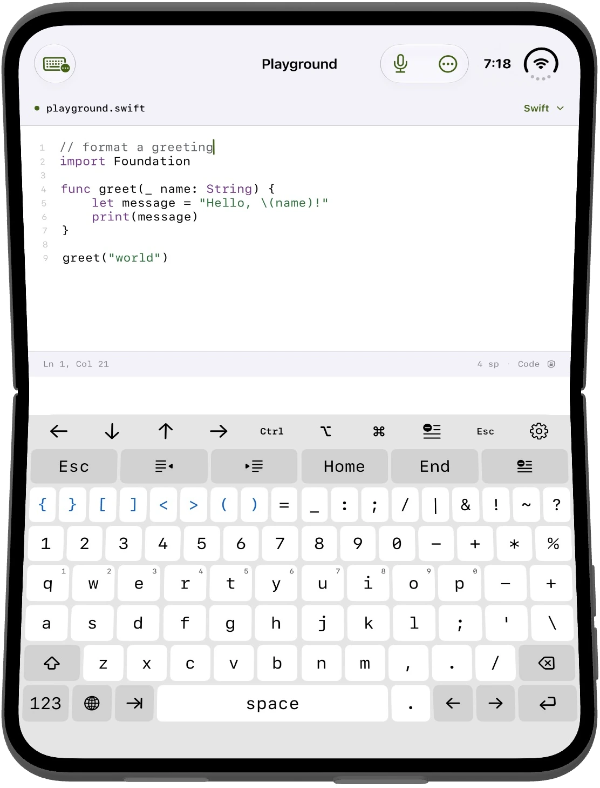

# TabForge: Code Keyboard

An MIT-licensed iOS keyboard for programming, scripting, terminals and remote desktops. Native UIKit input, a SwiftUI companion app, and an inspectable local editing engine.

[Source](https://github.com/jdodsoncollins/TabForge) · [Support](docs/SUPPORT.md) · [Privacy](PRIVACY.md) · [Security](SECURITY.md) · [Design](DESIGN.md) · [Contributing](CONTRIBUTING.md)



[Watch the 15-second video](https://www.jeremycollins.net/tabforge#overview). Native Simulator footage with synthetic code.

Support: [jeremy@jeremycollins.net](mailto:jeremy@jeremycollins.net). Use [private security reporting](SECURITY.md) for vulnerabilities, and synthetic examples for public bug reports.

## Privacy and transparency

A keyboard handles sensitive text. TabForge contains no application networking client, analytics, advertising, account service or automatic diagnostic uploader. The extension does not record a keystroke history or transmit typing. It does not request Full Access or use an App Group.

The keyboard saves its preferences and custom snippets in its own local container. Manage them from the keyboard's gear menu. The companion app **does save its playground draft locally** and does not synchronize keyboard settings or snippets. Voice input requires on-device recognition; it has no cloud fallback. User-triggered sharing, host apps, Apple system features and device backups have their own data handling. Read [PRIVACY.md](PRIVACY.md) for the complete boundaries, migration limits, and storage details.

The companion keyboard and layout guide are previews. Their settings and snippets are held only in memory for that app process and do not configure the installed keyboard.

The app's Settings screen links directly to this repository, its privacy documentation and its security policy. Licenses & notices displays the bundled MIT license and third-party notices offline. Public source makes review possible; it is not a claim of an independent security audit or proof that a distributed binary matches a particular commit.

The bottom of Settings includes framework and palette credits, creator details, and an Other Apps page for Codable and Taktung. Their icons are bundled; external pages open only when selected.

The App Store [privacy policy](https://www.jeremycollins.net/tabforge-privacy-policy) and [repository privacy documentation](PRIVACY.md) describe the same keyboard-local storage, temporary previews, and absence of Full Access or App Group sharing.

## See the keyboard

TabForge running in Apple's Simulator, with real device frames and synthetic code. These captures show the companion playground; keyboard space and control-sequence support depend on the host app.

| iPhone | iPad |
| --- | --- |
|  |  |

| Duo closed | Duo open | Duo partially opened |
| --- | --- | --- |
|  |  |  |

The Duo tabletop capture shows the keyboard using the lower display in the playground. It does not establish that every third-party app permits the same layout. [Capture and artwork provenance](docs/design-assets.md) distinguishes these Simulator images from physical-device validation.

## Keyboard features

- Accessible braces, brackets, angle brackets and full ASCII punctuation; Tab, indent/outdent, Delete Line, arrows, Ctrl, Option, Command and Escape.
- One short-press gear menu for editing actions, code suggestions or swipe alternatives, quick preferences, complete keyboard settings, and snippet creation, editing, deletion, and insertion. Installed-keyboard preferences live in the keyboard; companion previews use independent temporary settings.
- Width-based phone, wide-phone, expanded and iPad/Studio layouts. Guarded Duo fold/camera geometry supports open and tabletop layouts.
- Four compact rows for landscape phones and short windows, with an Fn editing layer at the same height. Automatic, Compact and Full height preferences.
- iOS Standard follows system Light/Dark; Darcula, Dracula and Nord provide code palettes. Light, Dark and Tinted app icons are included.
- Code editor, Terminal · ANSI and literal Remote desktop profiles. Host/client support determines which control sequences work.
- Optional conservative English prose autocorrect using Apple's public spelling service and supplementary lexicon. It defaults off, respects eligible host fields and skips code-like input. Space commits; immediate Delete restores the original spelling.
- Opt-in experimental swipe recognition over a bundled coding vocabulary, and companion voice-to-code with transcript review.
- Native playground selection, undo, syntax highlighting, line numbers and system Writing Tools where supported.
- Keyboard accessibility labels/state, overlapping key handling, Bold Text and Dynamic Type in settings. Physical assistive-technology and touch coverage has limits documented below.

## Build and enable

The app requires **Xcode 27.1 or later**, Swift 6 and **iOS/iPadOS 27.0+**. Duo-specific geometry is availability-guarded for 27.1. `KeyboardCore` is a standalone Swift package with a macOS 15 minimum.

Clone the repository, open `ScriptKeyboard.xcodeproj`, and choose the `ScriptKeyboard` scheme and an installed iOS simulator. The checked-in configuration uses generic `org.example.TabForge` identifiers and no signing team. The playground works before enabling the system extension. For a command-line Simulator build, pass `CODE_SIGNING_ALLOWED=NO`.

For a physical device or your own distribution, create a private configuration:

```sh
cp .env.example .env
# Edit .env with your Apple Developer team and unique app bundle ID.
python3 Scripts/configure-build.py
```

The two settings are `TABFORGE_DEVELOPMENT_TEAM` and `TABFORGE_BUNDLE_IDENTIFIER`. Register your app identifier and its `.Keyboard` extension identifier with your Apple Developer account. Test bundle IDs are derived with `.Tests` and `.UITests` suffixes. Xcode uses automatic signing with your local team. The app and extension have no App Group entitlement and do not request Full Access.

The script treats `.env` as data, validates identifiers, and writes `Configuration/Signing.local.xcconfig` with owner-only permissions. It does not run shell commands, fetch credentials, change the checked-in project, or print your values. Both files are ignored by Git. Run it again after changing `.env`; use `--check` to validate without writing. The public `Configuration/Build.xcconfig` optionally includes this local file, so XcodeGen regeneration keeps the public project generic. Remove the local file to return to the unsigned Simulator defaults.

No source edit is needed. Changing a distribution's identifiers creates different containers; this setup does not migrate existing drafts or snippets.

In iOS Settings, choose **General → Keyboard → Keyboards → Add New Keyboard → TabForge**, then use the globe to switch keyboards. Keyboard preferences and snippets stay in the keyboard's own local storage and are managed from its gear menu.

Internal targets retain the `ScriptKeyboard` name. Keep private signing overrides, credentials and provisioning profiles out of version control.

`project.yml` is the XcodeGen source of truth. The generated project is checked in. If you change the spec, regenerate with:

```sh
xcodegen generate
```

There are no external Swift package or runtime SDK dependencies. Apple system frameworks and palette/asset provenance are described in [THIRD_PARTY_NOTICES.md](THIRD_PARTY_NOTICES.md).

## Test

```sh
swift test
python3 -m unittest discover -s Scripts/tests
xcodebuild -project ScriptKeyboard.xcodeproj -scheme ScriptKeyboard \
  -destination 'platform=iOS Simulator,id=<SIMULATOR_UDID>' \
  CODE_SIGNING_ALLOWED=NO test
```

Choose an installed simulator with `xcrun simctl list devices available`. Core tests run in GitHub Actions; hosted UIKit/UI tests require the matching Xcode and simulator runtime. [Verification](docs/verification.md) distinguishes automated evidence from device checks. [AGENTS.md](AGENTS.md) provides contributor and coding-agent guidance.

## Platform limits

`UITextDocumentProxy` inserts text and exposes partial, nullable context; it cannot synthesize arbitrary hardware events. ANSI/control sequences work only when the terminal or remote client forwards them. Line edits decline when boundaries or cursor movement cannot be verified. Secure/password and phone fields use Apple's keyboard, and apps can decline custom keyboards.

Extensions cannot record microphone audio. iOS controls system dictation availability. The companion voice feature requires explicit microphone/Speech permissions and downloaded on-device English support. System Writing Tools and Dictation follow Apple's own availability and privacy rules.

Swipe is experimental and recognizes a small coding vocabulary rather than unrestricted prose. Apple's QuickPath decoder is not a public dependency. [Research](docs/swipe-engine-research-2026-10-17.md) covers possible replacements and their separate code, data and model licenses; none is integrated.

UIKit controls preserve cancellation, release-inside behavior, expanded hit regions, overlapping presses and modifier snapshots. Apple's private keyboard touch classifier is unavailable. Physical palm/edge rejection, full assistive-technology typing, floating/Split View keyboards, terminal forwarding and sustained extension memory pressure require device checks. iOS can terminate any keyboard extension.

## License

TabForge's original code, documentation and included project assets are offered under the [MIT license](LICENSE), subject to the provenance and retained third-party notices in [THIRD_PARTY_NOTICES.md](THIRD_PARTY_NOTICES.md). Apple platform components and third-party names retain their applicable terms.
